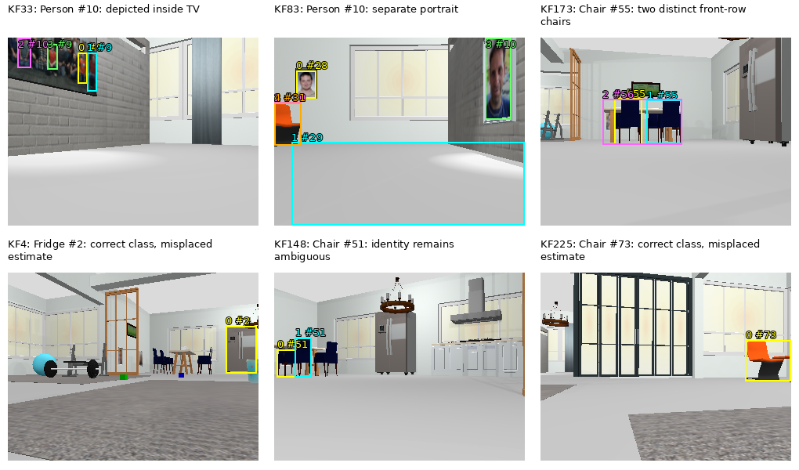
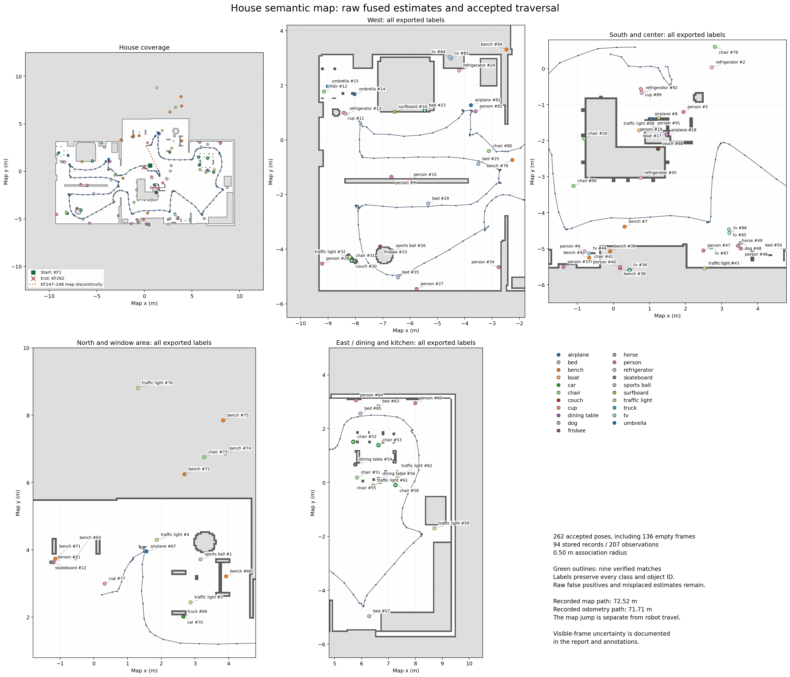

# Assignment 2 — Object detection and semantic localization in the house world

**Author:** Manish Chandra Tadishetty 
**Repository:** https://github.com/danny1409/turtlebot-maze

## Abstract

A Python detector subscribes to the TurtleBot's RGB, depth, odometry and TF streams over Zenoh and keeps a frame only when the robot has moved or turned enough. It runs YOLOv8 nano and batched CLIP on those frames and back-projects each detection that has valid depth into the map frame. A second process stores each object's current fused position and every individual sighting in PostgreSQL/pgvector. Detections of the same class within a fixed radius are merged, CLIP cosine similarity chooses between several candidates, and four parameterized queries read the objects and their histories back.

The final recording has **262 accepted keyframes with matching PNGs, 207 linked observations and 94 stored records** at an association radius of **0.50 m** (chosen before this run). It covers 329.4 s of ROS simulation time. The map and odometry paths are 72.52 m and 71.71 m long; both are sampled estimates, not measured travel. The map path has one jump, which I plot separately.

The pipeline works end to end, but physical accuracy is limited. Under my class/identity and planar-location matching rule, **nine matches are verified** and one more chair match is unresolved. That gives instance precision **0.096–0.106** and recall **0.391–0.435** against a 23-instance inventory. There are 94 records for 23 physical instances (ratio 4.087), and 43 records have classes that do not exist in the world. There are two confirmed cross-target merges and one possible chair merge. Sink and vase could not be scored from the 320 × 240 images, and I report that instead of inventing a rate.

All 52 Task 2–5 tests pass in the detector container, including the PostgreSQL ones (0 failures, 0 skipped).

## 1. Environment and files

The host is Windows with WSL Ubuntu. ROS 2 Jazzy and Gazebo run in the course Compose services. The perception process runs in a GPU Python container and does not import `rclpy`. All services use host networking, and only one world service runs at a time.

| Service | Role |
|---|---|
| demo-world-house | Gazebo house, TurtleBot, Nav2, localization, ROS sensors |
| zenoh-router | Message bus |
| zenoh-bridge | DDS/CDR-to-Zenoh transport |
| detector | YOLO/CLIP process and the Python environment for the semantic commands |
| vector | PostgreSQL/pgvector on host port **5436** |

The map is `house_world_map.yaml` (0.05 m cells, origin [-12.5, -12.5, 0], 500 × 500 image).

| File | Responsibility |
|---|---|
| `detector/object_detector.py` | CDR decoding, subscriptions, keyframes, YOLO/CLIP, depth sync, projection |
| `detector/embedding_ingest.py` | Storage, association, capture, queries, export, plotting |
| `detector/semantic_schema.sql` | The two required tables and indexes |
| `detector/tests/test_task2.py` … `test_task5.py` | Tests |

The evaluated database is `semantic_a2_20261012t005526z_ec6db6` and the detector run is `MSI-20261012T005529`. Raw PNGs and JSONL are files on disk. `semantic_objects` holds the fused estimates and `object_observations` keeps each measurement.

## 2. Task 1 — Detector data flow

I kept the reference structure: a `main()` with nested Zenoh callbacks, an ordinary Python process, and `pycdr2` `IdlStruct` decoding of the bridge's CDR messages. Keys: RGB `camera/color/image_raw`, depth `camera/depth/image_rect_raw`, odometry `odom`, TF on `tf` and `tf_static`, and detections published on `tb/detections`.

The callbacks keep bounded histories. RGB is limited to 10 Hz. The first valid pose starts the reference, and a later frame becomes a keyframe when the robot has moved at least 0.5 m or turned at least 15° (wrapped yaw). The reference pose advances only after a successful publish, so a stationary robot produces no further inference.

YOLOv8 nano (`yolov8n.pt`, all 80 COCO labels, confidence 0.3) runs on the colour frame (row stride respected, RGB→BGR). Retained detections are cropped, converted to RGB, and encoded in **one CLIP batch** per keyframe (`ViT-B-32`, `laion2b_s34b_b79k`). The 512-d outputs are L2-normalized and published as little-endian float32 together with the box, confidence, ROS timestamp and localization metadata.

My changes to the reference: wrapped motion gating, strict timestamp pairing, stride and depth validation, a tested optical-to-map transform chain, and explicit map-frame robot and camera poses. All COCO classes are kept, so unexpected predictions stay visible for evaluation.

For images, `embedding_ingest.py capture-views --out DIR` subscribes to RGB and `tb/detections` and saves the image whose ROS timestamp equals the keyframe's `timestamp_ns` (names `<run_id>_kf<id>.png`, plus `frame-index.jsonl`). It never substitutes a different timestamp, and empty keyframes are saved too.

## 3. Task 2 — Synchronization, depth and geometry

For each candidate RGB keyframe the detector picks the depth and odometry samples whose ROS header time is closest to the RGB stamp. It accepts them only if both differences are at most **200 ms** (inclusive). Matching uses timestamps, not arrival order. A 2 s wall-clock wait lets late messages arrive but does not loosen the 200 ms limit.

Depth is `32FC1` in metres, decoded with the message's byte order and padded row size. For each clipped box I take the central **50% × 50%** region (about 25% of the area), keep finite positive samples, reject the detection if fewer than **9** remain, and otherwise use the **median**. This avoids relying on one pixel between chair slats. It cannot guarantee that a large gap or background never dominates the region.

For box centre $(u, v)$ and depth $d$, the optical-frame point is

$$
x_o = (u-160)d/277.13,\qquad y_o = (v-120)d/277.13,\qquad z_o = d.
$$

The optical-to-body rotation is $(x_o,y_o,z_o)\to(z_o,-x_o,-y_o)$, and the camera mount adds $(0.064,-0.065,0.094)$ m in `base_link`. All steps are 4 × 4 matrices:

$$
p_{map}=T_{map\leftarrow base\_link}\,T_{base\_link\leftarrow camera}\,R_{camera\leftarrow optical}\,p_{optical}.
$$

`map ← odom` comes from Nav2's localization on `/tf` (the `tf` key). When odometry's child frame is `base_footprint`, the `base_footprint ← base_link` edge comes from `tf_static`. Dynamic transforms are taken nearest to the odometry time within 200 ms. A missing or stale transform rejects the frame; I never assume identity. The camera's map pose uses the same chain, so its quaternion includes the optical-axis rotation. The estimate is a visible surface point, not the furniture origin.

**Hand-computed test.** Box `[219.2825, 82.287, 239.2825, 102.287]` (centre pixel (229.2825, 92.287)), depth 2 m everywhere, robot pose in odom (1, 2, 0) with yaw +90°, and `map ← odom` translation (10, −3, 0.5) with yaw −90°:

| Stage | Coordinate (m) |
|---|---|
| Back-projected optical point | (0.5, −0.2, 2.0) |
| After optical-to-body rotation | (2.0, −0.5, 0.2) |
| After camera mount | (2.064, −0.565, 0.294) |
| Robot pose applied (odom) | (1.565, 4.064, 0.294) |
| `map ← odom` applied (map) | **(14.064, −4.565, 0.794)** |

`test_complete_chain_against_off_centre_hand_calculation` runs the box centre, depth and transforms through the implementation and compares with this point at absolute tolerance 1e-9 m. That checks the arithmetic, not sensor accuracy. The Task 2 suite has 11 tests: the full hand calculation, axis signs, out-of-order timestamps, the inclusive 200 ms boundary, median depth and too few samples, CDR decoding with padding and endianness, missing and stale TF, the base-footprint edge and its inverse, and the optical orientation.

In the live run `MSI-20261010T052957`, RGB-to-depth differences were 0 ms and RGB-to-odometry differences were 3–15 ms. The first keyframe took 1.51 s to process and later ones 0.01–0.07 s. Two early frames without `map ← odom` were rejected.

## 4. Task 3 — Semantic database

`semantic_schema.sql` creates the assignment's two tables and indexes with the same columns and types (the full SQL is in Appendix A). I only added `IF NOT EXISTS`. The `vector` extension supplies both `vector(512)` columns. Creating an object and inserting its observation happen in one transaction, so a failed observation never leaves an object without evidence.

| Stored value | Meaning |
|---|---|
| `semantic_objects.map_x/y/z` | The detection's object point in map, then the count-weighted fused point after merges |
| `object_observations.map_x/y/map_yaw` | The synchronized robot pose in map |
| Camera x/y/z and xyzw quaternion | Camera optical pose in map from the Task 2 chain |
| `seen_at_ns`, `first/last_seen_ns` | Integer ROS nanoseconds from the keyframe |
| `range_m` | **3D** distance from camera centre to the back-projected point, $\sqrt{x_o^2+y_o^2+z_o^2}$ |
| `bearing_rad` | $\operatorname{atan2}(-x_o, z_o)$: 0 along camera forward, **positive to the left** |
| Bounding box | Integer pixels enclosing the float box (floor of minima, ceil of maxima) |
| Observation `embedding` | The normalized CLIP vector for this detection |

I tested this on a fresh `semantic_assignment` database on the Compose PostgreSQL service. Keyframes 11–24 produced 9 observations linked to 9 object estimates with no insert errors, separate object and robot positions, integer ROS times, and 512-d embeddings. Those were initial estimates before Task 4 merging, so they are not physical instance counts.

## 5. Task 4 — Association and calibration

A new detection is compared with stored objects of the **same class** whose current fused position is within a **3D Euclidean radius $r$** (boundary included) of the detection:

$$
class_{stored}=class_{detected},\qquad \|\bar p_{stored}-p\|_2\le r.
$$

| Candidates | Behavior |
|---|---|
| None | Insert an object with count 1, then its observation |
| One | Merge with it; no appearance threshold |
| Several | Pick the smallest `mean_embedding <=> new_embedding` (highest CLIP cosine similarity); an exact tie goes to the smallest object ID |

For an object with $n$ observations the update is

$$
\bar p_{n+1}=\frac{n\bar p_n+p_{n+1}}{n+1},\qquad
e'=\frac{n\bar e_n+e_{n+1}}{n+1},\qquad
\bar e_{n+1}=\frac{e'}{\|e'\|_2}.
$$

Every accepted detection also gets its own observation row. The count goes up by one, `first_seen_ns` is the minimum and `last_seen_ns` the maximum timestamp. Lookup, update and insert run in one transaction, with candidate rows locked and an advisory lock per class so writers cannot race.

**Choosing the radius.** I calibrated on a chair-study recording of 140 keyframes. I reviewed every image and labeled the chairs by position relative to the table, independent of radius, CLIP score or record ID. That gave eight reviewed detections of three physical chairs (KF104 stayed unresolved and was excluded).

| Measurement | Result |
|---|---|
| Depth noise, stationary probe (60 images) | Std. dev. 0 m at float32 precision (repeatability, not bias) |
| Box-centre spread after camera-rotation compensation | 0.20064 m and 0.04326 m (max 0.20064 m) |
| Same chair, opposite views (KF5/KF24, 93.7° apart) | 0.447971 m |
| Pairwise same-identity spread | Median 0.098 m, p95 0.397 m, max 0.448 m |
| Independent localization check (stationary robot, 16 matched TF samples) | About 0.233 m planar error, 1.27° yaw difference |

I replayed the eight detections offline at several radii (CLIP rule against a nearest-distance ablation):

| Radius (m) | Records | Extra duplicates | False-merge records | Notes |
|---:|---:|---:|---:|---|
| 0.15 | 5 | 2 | 0 | Splits same-chair pairs |
| 0.35 | 4 | 1 | 0 | KF5 and KF24 split |
| 0.45 | 3 | 0 | 0 | Only about 2 mm of margin |
| **0.50** | **3** | **0** | **0** | Selected |
| 0.65 | 3 | 0 | 0 | |
| 0.70 | 3 | 1 | 1 | CLIP picks the wrong chair; nearest picks the right one |
| 0.75 | 2 | 0 | 1 | Wrong merge with a single candidate |

I chose **0.50 m** because it covers the largest measured residual (0.448 m) with about 5 cm to spare and sits inside the zero-error range. This comes from one small sequence, not a guarantee for every chair or viewpoint. I froze the value before the final run.

**Final-route check.** On the final recording I replayed the 30 individually identified detections of six physical chairs (all 43 chair predictions took part in association):

| Radius (m) | Tie-break | Chair records | Extra duplicates | False merges |
|---:|---|---:|---:|---:|
| 0.15 | clip / nearest | 20 | 4 / 4 | 0 / 0 |
| 0.35 | clip / nearest | 16 | 2 / 3 | 0 / 1 |
| 0.45 | clip / nearest | 13 | 1 / 1 | 0 / 0 |
| **0.50** | clip / nearest | 13 | 2 / 2 | 1 / 1 |
| 0.75 | clip / nearest | 12 | 1 / 1 | 1 / 1 |
| 1.00 | clip / nearest | 11 | 1 / 0 | 2 / 1 |

The small calibration's zero-error result did not carry over to the longer route: at 0.50 m there are two extra records and one confirmed chair merge. 0.45 m would have looked slightly better in hindsight, but I kept the pre-chosen value. CLIP cannot fix a wrong single-candidate merge or a wrong class.

## 6. Task 5 — Parameterized queries

All queries are constant SQL run as `cursor.execute(QUERIES[name], parameters)`, with `%s` in place of the website's `$1`. Class names, coordinates and IDs are never interpolated into SQL. Missing classes or IDs return empty lists.

```sql
-- nearest (x, y, class_name): horizontal XY distance
SELECT object_id, class_name, map_x, map_y, map_z,
       sqrt(power(map_x - %s, 2) + power(map_y - %s, 2)) AS distance
FROM semantic_objects WHERE class_name = %s
ORDER BY distance, object_id LIMIT 1;

-- region (xmin, xmax, ymin, ymax)
SELECT object_id, class_name, map_x, map_y, map_z, observation_count
FROM semantic_objects
WHERE map_x BETWEEN %s AND %s AND map_y BETWEEN %s AND %s
ORDER BY class_name, object_id;

-- histogram (no parameters): objects, not sightings
SELECT class_name, count(*) AS object_count FROM semantic_objects
GROUP BY class_name ORDER BY object_count DESC, class_name;

-- poses (object_id)
SELECT observation_id, seen_at_ns, map_x, map_y, map_yaw,
       camera_x, camera_y, camera_z, bearing_rad, range_m, confidence
FROM object_observations WHERE object_id = %s
ORDER BY seen_at_ns, observation_id;
```

| Query on the final database | Result |
|---|---|
| `nearest chair 0 0` | Record **#20**, distance 2.106 m |
| `region -12.5 12.5 -12.5 12.5` | **94** records |
| `histogram` | **21** classes; most numerous: person 17, chair 13, bench 12 |
| `poses 55` | **12** evidence rows |

Record #20 is actually the back of a couch labeled as a chair, so the query returns the nearest *stored* chair, not a real one. Object #55 shows the two-chair merge in its history. Its 12 rows are not 12 independent poses, because several frames hold two sightings of the same record. The export uses one repeatable-read, read-only transaction and keeps all object and observation columns, including vectors.

## 7. Recording audit

| Audit | Result |
|---|---:|
| Accepted keyframes / matching 320 × 240 PNGs | 262 / 262 |
| Empty keyframes | 136 |
| Observations / complete evidence rows | 207 / 207 |
| Stored records | 94 |
| Missing image links / unmatched evidence | 0 / 0 |
| RGB–depth maximum difference | 0 ms |
| RGB–odometry maximum difference | 18 ms |
| ROS time span | 329.4 s (1.002–330.402 s) |
| Depth-rejected YOLO boxes | 162 |
| Map-pose bounds | x −8.003…8.247 m, y −4.960…4.122 m |
| Map / odometry path length | 72.518 / 71.711 m |

Every observation links to its detection by stamp, class, box and embedding. Embeddings are finite, normalized and 512-d, and every object count equals its linked rows. An offline replay reproduces **all 207 live object IDs** at 0.50 m. The route covers the living and dining areas, bedroom, kitchen and dining chairs from several sides, and later revisits. It does not claim a percentage of the reachable floor.

I did not record a clean wall-clock start and end, so the duration is the 329.4 s of ROS time. Between KF247 and KF248 the map position jumps 2.868 m while odometry moves 0.166 m (with a 10.4 s gap and some rotation). That looks like a localization correction, not a measured 2.868 m error, and the map plot breaks the route there.

## 8. Ground truth and evaluation

The world SDF has 87 placed models using 63 assets. By my declared mapping to COCO, **23 instances in 11 classes** exist:

| Class | Instances | Class | Instances |
|---|---:|---|---:|
| chair | 8 | couch | 1 |
| dining table | 4 | bed | 1 |
| tv | 2 | sink | 1 |
| sports ball | 2 | refrigerator | 1 |
| bench | 1 | spoon | 1 |
| vase | 1 | | |

Counting choices: every placed model counts separately, even repeated assets. Dining table covers KitchenTable, BalconyTable, CoffeeTable and ReadingDesk (a meal-tables-only policy would give 2). The integrated KitchenCabinet sink counts once. The ladle counts as the spoon. The weight bench counts as a bench, and the cooktop is neither a bench nor an oven. People and objects printed on pictures are not counted as real instances. These are evaluation labels; the runtime still emits all COCO classes.

**Matching.** Let G be physical instances, S stored records, and M one-to-one correct matches. Precision = M/S, recall = M/G, duplicate rate = S/G (ideal 1.0). A match needs the right class and visual identity, an unmixed history, and a fused XY position within **0.50 m of the object's registered footprint**. I picked that tolerance myself; it is not part of the assignment. World-to-map alignment uses the independent registration from four static chair footprints (residual about 3 mm, yaw −0.28°). Identity comes from reviewing the camera boxes, not from nearest coordinates.

Nine records qualify: chairs #31, #52, #53, #58, bed #23, sports ball #26, tv #36, dining table #54 and couch #88. Chair #51 is unresolved because its overlapping boxes cannot settle whether its history is pure. That gives chair M = 4–5 and total M = **9–10**.

**Per-class results** (classes with a physical instance or a stored record):

| Class | True | Stored | Matches | Precision | Recall | Dup. rate | Detection rate (C/E range) | False merges | Misses |
|---|---:|---:|---:|---:|---:|---:|---:|---:|---:|
| chair | 8 | 13 | 4–5 | 0.308–0.385 | 0.500–0.625 | 1.625 | 0.116–0.141 | 1 (+1 possible) | 3–4 |
| couch | 1 | 2 | 1 | 0.500 | 1.000 | 2.000 | 0.008–0.011 | 0 | 0 |
| bed | 1 | 8 | 1 | 0.125 | 1.000 | 8.000 | 0.188–0.250 | 0 | 0 |
| dining table | 4 | 2 | 1 | 0.500 | 0.250 | 0.500 | 0.030–0.042 | 0 | 3 |
| tv | 2 | 7 | 1 | 0.143 | 0.500 | 3.500 | 0.086–0.130 | 0 | 1 |
| sports ball | 2 | 2 | 1 | 0.500 | 0.500 | 1.000 | 0.050–0.068 | 0 | 1 |
| refrigerator | 1 | 5 | 0 | 0.000 | 0.000 | 5.000 | 0.011–0.015 | 0 | 1 |
| bench | 1 | 12 | 0 | 0.000 | 0.000 | 12.000 | 0.000 | 0 | 1 |
| spoon | 1 | 0 | 0 | N/A | 0.000 | 0.000 | 0.000 | 0 | 1 |
| sink | 1 | 0 | 0 | N/A | 0.000 | 0.000 | N/A (unscorable) | 0 | 1 |
| vase | 1 | 0 | 0 | N/A | 0.000 | 0.000 | N/A (unscorable) | 0 | 1 |

Classes with no physical instance but stored records (precision 0, recall N/A): person 17 (1 confirmed false merge), traffic light 9, airplane 4, cup 3, umbrella 2, and one each of car, truck, boat, dog, horse, frisbee, skateboard and surfboard. That is **43 of 94 records (45.7%)**. Every other COCO class has no instance and no record.

**Detection rate.** I reviewed all 262 images. C is frames with at least one correct retained detection of the class, E is clearly relevant frames, and U is uncertain frames (tiny, border, occluded). I report C/E and the range [C/(E+U), C/E]. These are annotation bounds, not confidence intervals. The pipeline did not save labels for the 162 depth-rejected boxes, so these rates describe retained outputs, not raw YOLO.

| Class | C | E | U | C/E |
|---|---:|---:|---:|---:|
| bench | 0 | 27 | 35 | 0.000 |
| sports ball | 5 | 74 | 27 | 0.068 |
| spoon | 0 | 10 | 34 | 0.000 |
| chair | 21 | 149 | 32 | 0.141 |
| couch | 1 | 88 | 34 | 0.011 |
| bed | 3 | 12 | 4 | 0.250 |
| dining table | 5 | 118 | 47 | 0.042 |
| tv | 6 | 46 | 24 | 0.130 |
| sink | 0 | 0 | 42 | N/A |
| refrigerator | 1 | 65 | 22 | 0.015 |
| vase | 0 | 0 | 39 | N/A |

A correct label can still have a wrong position. The refrigerator's box is right, but its fused point (#2) fails the footprint test, and chair #73 is a correct orange-chair label with an implausible location. The kitchen table has two records but only one table is matched.

## 9. Failure cases

- Chair **#55** mixes the southwest and southeast front-row chairs (KF173). With one candidate and a moving mean, nearby chairs can merge.
- Person **#10** merges a person on a TV screen with a wall portrait. No real people are in the house.
- Chair **#51** may mix nearby dining chairs, but the boxes overlap too much to count a second merge.
- Trash cans become cups, orange chairs become bench or traffic light, portraits become people, and framed landscapes become tv. Floor regions become bed records. A correct transform and repeatable depth do not stop a wrong box or label from producing a plausible map point.
- Some correct-class detections are badly placed. I do not have continuous robot ground truth for this route, so depth, calibration and localization errors cannot be separated.
- The camera is low, so countertops, small utensils and high objects are rarely visible. Broad route coverage does not mean every object was seen.



## 10. Map and coverage



The overview shows the occupancy grid, start and end, and all accepted poses. The detail panels label all 94 records, including false positives. Green outlines mark the nine verified matches, and the map jump is drawn as a separate segment.

## 11. Verification and deliverables

| Check | Evidence |
|---|---|
| Task 2 transform and CDR tests | 11 passed in my earlier Docker run |
| Task 3–4 storage, association and measurement tests | 33 passed in my earlier Docker run |
| All Task 2–5 tests, PostgreSQL enabled | **52 checks, 0 failures, 0 skipped (1.2 s)**, in the detector container after rebuilding the images on October 12, 2026 |
| Capture and data audit | 262 exact image links; 207 observations, counts, means and vectors verified |
| Offline association replay | All 207 live object IDs reproduced at 0.50 m |
| Fresh-clone run | Not yet done; the rebuilt stack and the tests were verified on my machine |

Run the tests from the repository root with
`docker compose exec -T detector python -B -m unittest discover -s tests -p 'test_task[2345].py' -v`.

**Deliverables** (all under `detector/`, `assignments/assignment-2/` and `results/assignment-2/`):
1. Detector source: CDR, subscriptions, keyframe gate, YOLO, batched CLIP.
2. Depth matching, central-median estimate and map projection.
3. The transform unit test with the hand-computed result (14.064, −4.565, 0.794).
4. The exact SQL schema, input validation and transactional ingest.
5. Same-class radius and CLIP deduplication, with the calibration and final-route tradeoff.
6. Four parameterized queries with actual result files.
7. Complete JSON and COPY-format SQL exports.
8. The labeled map with every record and the accepted-pose coverage.
9. This report and a short README with the Compose, database, capture, test, query, export and restore commands.

## Appendix A: Exact SQL schema

```sql
CREATE EXTENSION IF NOT EXISTS vector;

CREATE TABLE IF NOT EXISTS semantic_objects (
    object_id BIGSERIAL PRIMARY KEY,
    class_name TEXT NOT NULL,
    map_x DOUBLE PRECISION NOT NULL,
    map_y DOUBLE PRECISION NOT NULL,
    map_z DOUBLE PRECISION NOT NULL,
    observation_count INTEGER NOT NULL CHECK (observation_count > 0),
    mean_embedding vector(512) NOT NULL,
    first_seen_ns BIGINT NOT NULL,
    last_seen_ns BIGINT NOT NULL
);
CREATE INDEX IF NOT EXISTS semantic_objects_class_name_idx
    ON semantic_objects (class_name);

CREATE TABLE IF NOT EXISTS object_observations (
    observation_id BIGSERIAL PRIMARY KEY,
    object_id BIGINT NOT NULL REFERENCES semantic_objects (object_id) ON DELETE CASCADE,
    seen_at_ns BIGINT NOT NULL,
    map_x DOUBLE PRECISION NOT NULL,
    map_y DOUBLE PRECISION NOT NULL,
    map_yaw DOUBLE PRECISION NOT NULL,
    camera_x DOUBLE PRECISION NOT NULL,
    camera_y DOUBLE PRECISION NOT NULL,
    camera_z DOUBLE PRECISION NOT NULL,
    camera_qx DOUBLE PRECISION NOT NULL,
    camera_qy DOUBLE PRECISION NOT NULL,
    camera_qz DOUBLE PRECISION NOT NULL,
    camera_qw DOUBLE PRECISION NOT NULL,
    bearing_rad DOUBLE PRECISION NOT NULL,
    range_m DOUBLE PRECISION NOT NULL,
    bbox_xmin INTEGER NOT NULL,
    bbox_ymin INTEGER NOT NULL,
    bbox_xmax INTEGER NOT NULL,
    bbox_ymax INTEGER NOT NULL,
    confidence REAL NOT NULL,
    embedding vector(512) NOT NULL
);
CREATE INDEX IF NOT EXISTS object_observations_object_id_idx
    ON object_observations (object_id);
```

## Appendix B: Sources and AI assistance

The requirements come from the course assignment page ([aegean.ai object detection](https://aegean.ai/aiml-common/assignments/topics/ROS/object-detection)), which I checked on October 11, 2026. The implementation adapts the course's reference detector and ingest code. The pgvector documentation defines the cosine-distance operator (`<=>`): https://github.com/pgvector/pgvector. PostgreSQL's locking and transaction behaviour is in its official documentation.

The evidence is my own recording: the keyframe PNGs, detections, query outputs, world and model files, and Docker test logs. The earlier calibration and stationary checkpoint are separate studies. Image review labels the physical screens and portrait surfaces in the house; it does not identify the real people shown in textures.

**AI assistance:** I used AI assistants (ChatGPT/Codex earlier in the work and Claude for the evaluation and report) for debugging, test preparation, reviewing data and drafting this report. I ran the system, checked the results, and am responsible for the submitted work, consistent with the course details.
