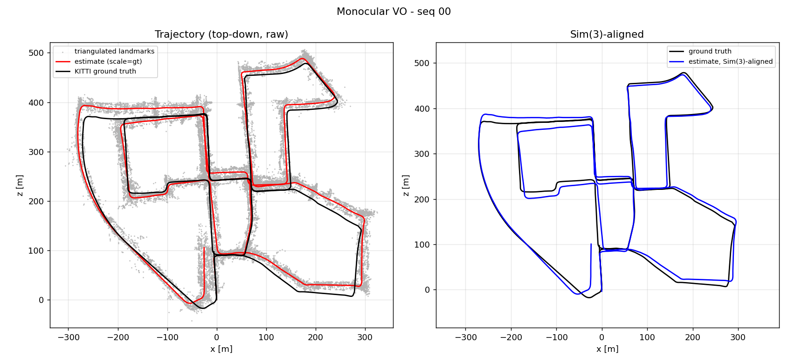

# Assignment 3: Visual SLAM

**Date of submission:** 2026-11-23

Three parts: a monocular visual odometry pipeline written from first principles and
evaluated on KITTI (Task 1), StellaVSLAM on a reference dataset and on my own room with
a calibrated webcam (Task 2), and StellaVSLAM integrated with Nav2 so a TurtleBot
navigates the maze without a prior map (Task 3).

| File | Contents |
|---|---|
| [`vo.py`](vo.py) | Task 1: monocular visual odometry pipeline |
| [`trajectory.png`](trajectory.png) | Task 1: KITTI sequence 00 trajectory vs ground truth |
| [`TUTORIAL.md`](TUTORIAL.md) | Task 3: the class tutorial (includes the Dockerfile, config and scripts in its Appendix A) |
| `Task-2 video link`, `Task-3 demo link` | the YouTube links below |

**Videos:** Task 2: https://youtu.be/0U4zF5w1TP4 · Task 3 demo: https://youtu.be/2G6iNnKbq1c

---

## Task 1: Monocular visual odometry from first principles

### Implementation (`vo.py`)

Following the *Visual Odometry Series* lectures (Part 1: concept and math; Part 2:
monocular VO code), using OpenCV for the geometric solvers:

1. **Features.** `--tracker orb`: ORB detection + Hamming kNN matching with Lowe's ratio
   test (0.75). `--tracker klt`: FAST corners tracked with pyramidal Lucas-Kanade
   optical flow, forward-backward consistency check (< 1 px), re-detection when tracks
   drop below half.
2. **Parallax gate.** Frame pairs with median flow < 1 px are skipped (stationary car:
   the essential matrix is degenerate).
3. **Essential matrix** with the 5-point algorithm in RANSAC (`findEssentialMat`, 1 px).
4. **Decomposition** into R and t with the cheirality check (`recoverPose`); t is unit length.
5. **Triangulation** (`triangulatePoints`) of inliers, keeping points with positive depth
   in both views and < 2 px reprojection error.
6. **Scale** (monocular t has no scale):
   - `rel`: propagate scale from the depths of points triangulated in the previous step;
   - `ground`: metric scale from the known camera height above the road (KITTI 1.65 m):
     find the dominant height of triangulated points in the lower image, median-filtered;
   - `gt`: oracle per-step distance from ground truth (to isolate geometry errors).
7. **Trajectory:** chain relative poses, `T_w,k = T_w,k-1 · inv([R|t])`.

**Metrics:** absolute trajectory error (ATE RMSE) after SE(3) and Sim(3) (Umeyama)
alignment, and the KITTI segment errors (translation %, rotation °/m over 100-800 m).

### Results on KITTI odometry sequence 00 (4541 frames, 3.72 km)

| Tracker | Scale | ATE SE(3) | ATE Sim(3) | KITTI t_err | r_err |
|---|---|---|---|---|---|
| ORB | rel | 143.22 m | 134.87 m | 40.66 % | 0.0358 °/m |
| ORB | ground | 208.24 m | 112.38 m | 29.86 % | 0.0358 °/m |
| **KLT** | **ground (no GT)** | **49.09 m** | **29.17 m** | **9.28 %** | **0.0066 °/m** |
| KLT | gt (oracle) | 13.81 m | 13.35 m | 1.30 % | 0.0066 °/m |



*`trajectory.png`: the KLT run with ground-truth step lengths (oracle scale), i.e. the
geometry-only upper bound. Left: raw estimate (red) with triangulated landmarks (grey)
over ground truth (black). Right: the same estimate after Sim(3) alignment. The
remaining 13.35 m error is heading drift; the pure-monocular run (KLT + ground-plane
scale) has the same shape but 13 % too long a path.*

### Analysis

**Where the error of the first run (ORB, rel) came from.** I recomputed the trajectory
from the saved poses, substituting ground truth for one quantity at a time:

| Diagnostic | Aligned trajectory RMSE |
|---|---|
| Original run | 134.87 m |
| Correct each step's distance only | 93.09 m |
| Correct camera orientation only | 82.52 m |
| Correct both | 9.87 m |

Scale drift and heading drift each explain a large part of the error, and only fixing
both brings it down to about 10 m. The 13 skipped (lost-tracking) updates account for
only 0.25 m of travel, so the problem is accumulation over thousands of successful
updates, not tracking failures.

**What fixed each part.**
- *Heading:* switching ORB matching to KLT tracking cut the rotation error 5x
  (0.0358 → 0.0066 °/m). Note that the scale method does not change rotation at all:
  both ORB runs have identical r_err.
- *Scale:* the ground-plane constraint replaces compounding scale propagation with an
  absolute measurement each frame: translation error 40.7 % → 9.3 % (with KLT).
- *Remaining error:* with oracle scale the error is 13.35 m (heading drift alone). With
  ground-plane scale it is 29.17 m, and the estimated path is 4.22 km instead of
  3.72 km (+13 %): the ground height is under-estimated when points above the road
  (curbs, parked cars) are counted as road.

**Failures and fixes along the way.** Around frame 550 (car stopped) the essential matrix
had 0 inliers and `triangulatePoints` crashed on empty input; degenerate pairs are now
treated as lost tracking, and the parallax gate skips near-static pairs.

**Limitations.** This is frame-to-frame VO: no map, no bundle adjustment, no loop
closure, so drift is unbounded. Tracking against a persistent landmark map (PnP + local
BA) would reduce heading drift, and loop closure would remove it on KITTI 00's many
loops. Tasks 2 and 3 use StellaVSLAM, which has all three.

### How to run

```bash
pip install opencv-python-headless numpy matplotlib
# KITTI odometry (grayscale) with poses: <root>/sequences/00/image_0, calib.txt, <root>/poses/00.txt
python vo.py --root /path/to/kitti --seq 00 --tracker klt --scale ground --out results/seq00_klt_ground
python vo.py --root /path/to/kitti --seq 00 --tracker klt --scale gt     --out results/seq00_klt_gt
```

Each run writes `trajectory.png`, `metrics.txt` (ATE and KITTI errors) and
`est_poses.txt` (KITTI pose format) to its `--out` folder.

---

## Task 2: StellaVSLAM on my own indoor space

StellaVSLAM runs in Docker (official `Dockerfile.desktop` from the stella_vslam repo,
Pangolin viewer through WSLg):

```bash
git clone --recursive https://github.com/stella-cv/stella_vslam.git && cd stella_vslam
docker build -t stella_vslam-desktop -f Dockerfile.desktop . --build-arg NUM_THREADS=2
docker run -it --rm --privileged -e DISPLAY=$DISPLAY -v /tmp/.X11-unix:/tmp/.X11-unix:ro \
  -v <your data folder>:/data stella_vslam-desktop
# inside the container (orb_vocab.fbow, aist_living_lab_1/video.mp4 and room1.mp4 in /data):
./run_video_slam -v /data/orb_vocab.fbow -m /data/aist_living_lab_1/video.mp4 \
  -c /data/equirectangular.yaml --frame-skip 3 --map-db-out /data/aist_map.msg
./run_video_slam -v /data/orb_vocab.fbow -m /data/room1.mp4 \
  -c /data/my_camera.yaml --frame-skip 1 --map-db-out /data/room_map.msg
```

The vocabulary (`orb_vocab.fbow`, from github.com/stella-cv/FBoW_orb_vocab), the
dataset video and my videos are not committed because of their size.

### Reference dataset (`aist_living_lab_1`)

StellaVSLAM built in Docker (`Dockerfile.desktop`, Pangolin viewer through WSLg; built
with `NUM_THREADS=2` because more parallel jobs ran WSL out of memory), run with the
equirectangular config (`--frame-skip 3`).


### Camera calibration

Recorded about 50 s of video of a 9 x 6 chessboard shown full-screen on a phone, with
the same camera and resolution (1920 x 1080) as the room video.

Zhang's method (OpenCV `calibrateCamera`), from a video of a 9 x 6 chessboard shown on a
phone screen, recorded with the laptop webcam at 1920 x 1080:

| | Value |
|---|---|
| Views used | 39 (from 59 still frames; 1 outlier view dropped) |
| RMS reprojection error | **0.31 px** |
| fx, fy | 1246.4, 1246.9 px |
| cx, cy | 962.1, 536.2 px (image centre 960, 540) |
| k1, k2, p1, p2, k3 | 0.189, -0.522, -0.0002, 0.0014, 0.397 |
| Field of view | 75.2° horizontal, 46.8° vertical |

All plausibility checks pass (positive focal lengths, square pixels, principal point
near the centre, plausible FOV). A second, independent calibration video gave the same
camera (fx ≈ 1250, principal point (961, 535)).

**Lesson from the first attempt:** using every frame gave RMS 2.5 px and fx jumping
between 1260 and 1410 depending on which frames were used. The board was moving in 95 %
of frames (blur and rolling-shutter error). The script now keeps only frames where the
board moved < 1 px and picks up to 40 that cover the whole image. Low reprojection
error alone is not proof of a good calibration (the point of the lecture's
meeting-room example); stability across subsets and plausibility checks are.

`my_camera.yaml` is built from `example/aist/equirectangular.yaml` as required:
the camera model changes from equirectangular to perspective (the 360° model has no
camera matrix to replace), the calibrated fx, fy, cx, cy and k1, k2, p1, p2, k3 are added,
and the 360-camera mask rectangles are removed. The header of the file lists every change.

### My room


- **First recording failed:** I measured only 100-300 ORB features per frame (out of 2000
  requested): the camera pointed mostly at blank walls and the ceiling, a lamp shone into
  the lens, and the motion was fast. StellaVSLAM initialised with ~70 points and lost
  tracking on the next frame. Calibration was ruled out by undistorting a frame.
- **Second recording** (`room1.mp4`, camera aimed at the furniture, slow sideways start):
  initialised at frame 42 with 67 points and tracked for about 1000 frames (to frame
  1043, roughly 33 s) before tracking was lost. An earlier run on the same video
  initialised at frame 204 with 51 points and tracked to frame 1051.

**YouTube video (reference run, calibration and my room):** https://youtu.be/0U4zF5w1TP4

---

## Task 3: StellaVSLAM + Nav2, navigating the maze without a prior map

Full tutorial (architecture, Dockerfile walkthrough, how the integration works,
recursive state estimation view, commands, verification, troubleshooting):
**[`TUTORIAL.md`](TUTORIAL.md)**. Its Appendix A contains every file needed
(Dockerfile, camera config, Nav2 params script, run scripts).

**Summary.** StellaVSLAM runs in RGB-D mode on the TurtleBot's simulated RealSense D435i
in its own ROS 2 Jazzy container (`Dockerfile.stella_vslam_ros_jazzy`, with two Jazzy
build fixes and one tracking fix for noise-free simulated images) and publishes
`map → odom`. Nav2 runs with `use_localization:=False` (no map_server, no AMCL) and a
rolling-window global costmap built from the LiDAR (`make_nav2_params_vslam.py`).

**Reference run:** 8 goals sent in RViz, all 7 completed goals succeeded (one was
replaced by a new goal), no tracking loss, **2 loop closures** with default settings
(keyframes 244-345 and 265-370), final map 456 keyframes and 23,322 landmarks. The
robot's start position in `map`, (-0.07, 0.04), matches the camera's mounting offset,
because the SLAM map's origin is the camera pose at initialisation.


### How to run

Save the files from Appendix A of the tutorial in `~/vslam_nav2`, then:

```bash
cd ~/vslam_nav2
docker build -t stella_vslam_ros:jazzy -f Dockerfile.stella_vslam_ros_jazzy . --build-arg NUM_THREADS=2
TB_REPO=~/robotics/turtlebot-maze ./run_sim_no_map.sh     # terminal 1
./run_vslam.sh                                            # terminal 2, once Gazebo and RViz are up
```

Then send **Nav2 Goal**s in RViz. Verification commands are in section 8 of the tutorial.

**Demo video:** https://youtu.be/2G6iNnKbq1c

---

## Tests

- Task 1: `vo.py` was checked on a synthetic KITTI-format sequence with known poses
  before running on KITTI; on KITTI the metrics are computed against the ground-truth
  poses (`metrics.txt`).
- Task 2: the calibration script was validated on a synthetic chessboard video rendered
  with known intrinsics (recovered fx within 0.1 px), and on two independent recordings
  of my webcam that gave the same camera.
- Task 3: the verification checks in section 8 of `TUTORIAL.md` (no AMCL/map_server,
  VSLAM pose rate, `map → odom` present, single TF tree).
